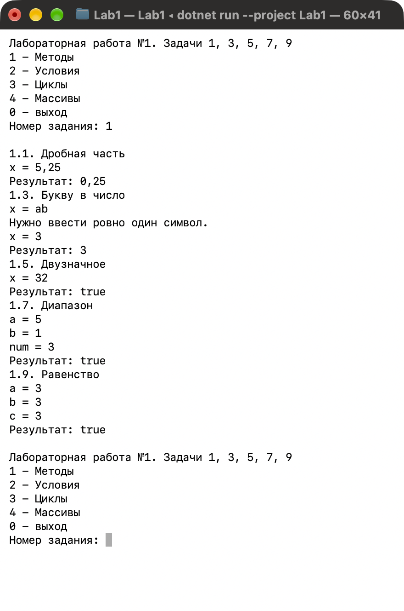
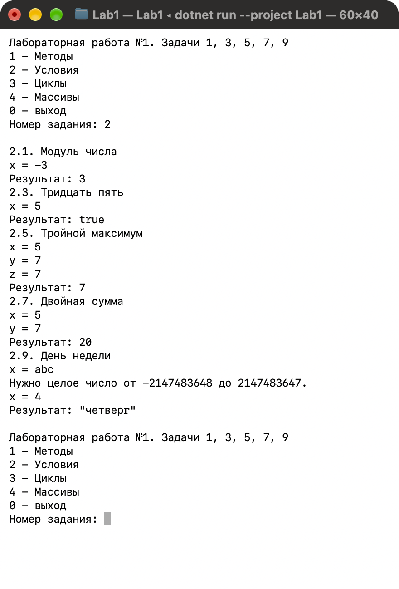
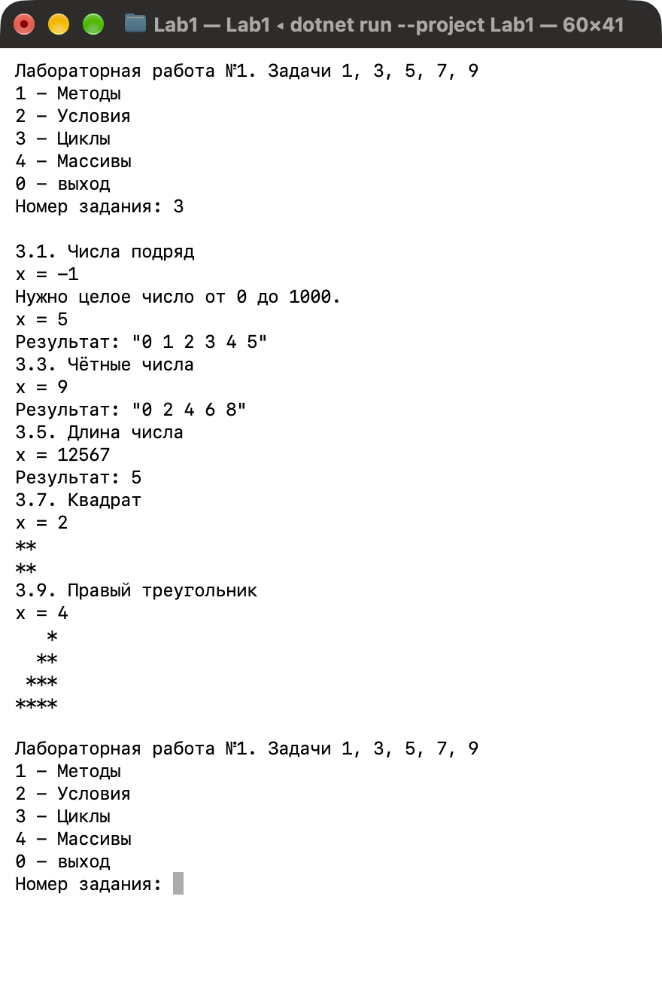
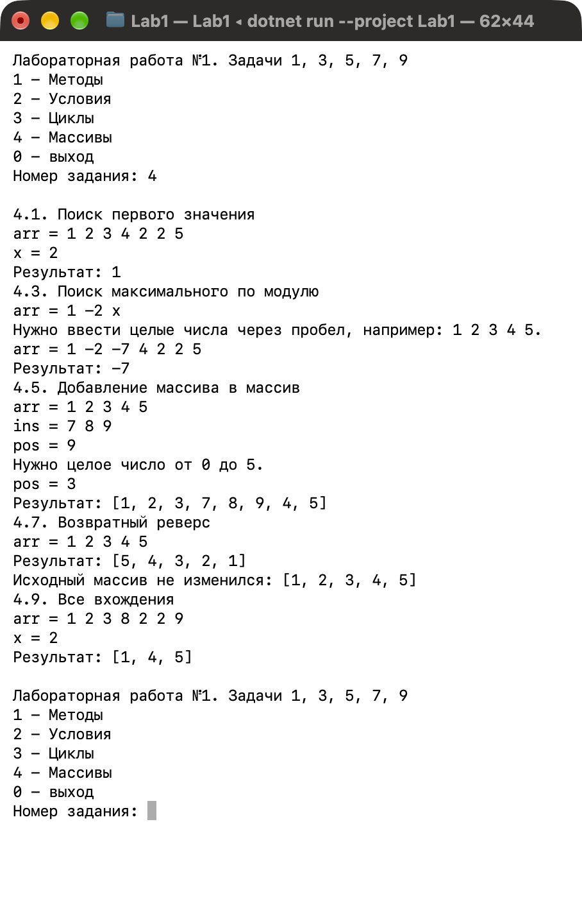

# Лабораторная работа №1. Процедурное программирование

Выполнил: Владимиров Савелий Олегович, ИТ-1  
Задачи: 1, 3, 5, 7, 9 из каждого задания

## Запуск

```bash
dotnet run --project Lab1/Lab1.csproj
```

В меню выбирается задание 1–4, затем программа по очереди вызывает его пять методов и спрашивает исходные данные. При неверном вводе вопрос повторяется.

## Решение

Все задачи — методы одного класса `Tasks` (`Lab1/Tasks.cs`). Методы статические, так как не используют данные объекта. Имена записаны в `PascalCase`, как принято в C# (`fraction` → `Fraction`, `charToNum` → `CharToNum` и т. д.). Ввод с проверкой — в классе `ConsoleInput`, меню — в `Program`.

| Задание | Задача | Метод |
| --- | --- | --- |
| 1. Методы | 1 Дробная часть | `Fraction(double x)` — `x - (long)x` |
| | 3 Букву в число | `CharToNum(char x)` — `x - '0'` |
| | 5 Двузначное | `Is2Digits(int x)` — от 10 до 99 по модулю |
| | 7 Диапазон | `IsInRange(int a, int b, int num)` — границы в любом порядке |
| | 9 Равенство | `IsEqual(int a, int b, int c)` |
| 2. Условия | 1 Модуль числа | `Abs(int x)` |
| | 3 Тридцать пять | `Is35(int x)` — делится ровно на одно из 3 и 5 |
| | 5 Тройной максимум | `Max3(int x, int y, int z)` — два `if` без вложенности |
| | 7 Двойная сумма | `Sum2(int x, int y)` — сумма 10–19 заменяется на 20 |
| | 9 День недели | `Day(int x)` — через `switch` |
| 3. Циклы | 1 Числа подряд | `ListNums(int x)` |
| | 3 Чётные числа | `Chet(int x)` — цикл с шагом 2, без `if` |
| | 5 Длина числа | `NumLen(long x)` — цикл `do while`, у числа 0 длина 1 |
| | 7 Квадрат | `Square(int x)` |
| | 9 Правый треугольник | `RightTriangle(int x)` |
| 4. Массивы | 1 Поиск первого значения | `FindFirst(int[] arr, int x)` |
| | 3 Поиск максимального | `MaxAbs(int[] arr)` — возвращает значение со знаком |
| | 5 Добавление массива в массив | `Add(int[] arr, int[] ins, int pos)` |
| | 7 Возвратный реверс | `ReverseBack(int[] arr)` — новый массив, исходный не меняется |
| | 9 Все вхождения | `FindAll(int[] arr, int x)` — сначала подсчёт, потом заполнение |

Проверяемые граничные случаи: символ, не являющийся цифрой; переполнение `int` в `Sum2` (выводится сообщение); модуль `int.MinValue` не вводится; пустой массив в `MaxAbs` не принимается; позиция вставки только от 0 до длины массива; отрицательные размеры фигур и границы списков не принимаются.

## Результаты

Скриншоты сделаны при запуске `dotnet run` в терминале. Входные данные взяты из примеров методички, плюс в каждом задании показан один неверный ввод.

### Задание 1. Методы

`5,25` → `0,25`; `'3'` → `3` (строка `ab` отклонена); `32` → `true`; `5 1 3` → `true`; `3 3 3` → `true`.



### Задание 2. Условия

`-3` → `3`; `5` → `true`; `5 7 7` → `7`; `5 + 7` → `20`; `4` → «четверг» (строка `abc` отклонена).



### Задание 3. Циклы

`-1` отклонено, `5` → «0 1 2 3 4 5»; `9` → «0 2 4 6 8»; `12567` → `5`; квадрат 2 × 2; правый треугольник высотой 4.



### Задание 4. Массивы

`[1,2,3,4,2,2,5]`, 2 → `1`; `[1,-2,-7,4,2,2,5]` → `-7` (строка с буквой отклонена); вставка `[7,8,9]` в позицию 3 (позиция 9 отклонена) → `[1, 2, 3, 7, 8, 9, 4, 5]`; реверс → `[5, 4, 3, 2, 1]`; все вхождения 2 → `[1, 4, 5]`.


